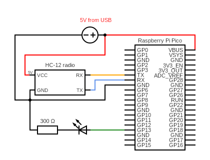
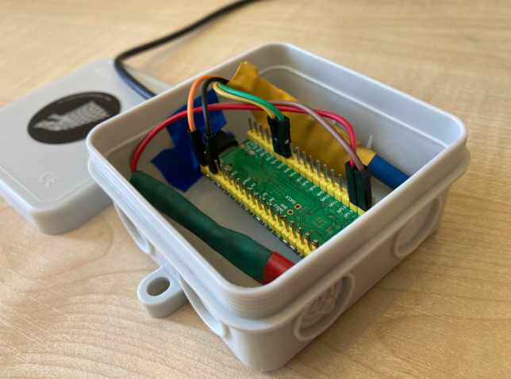
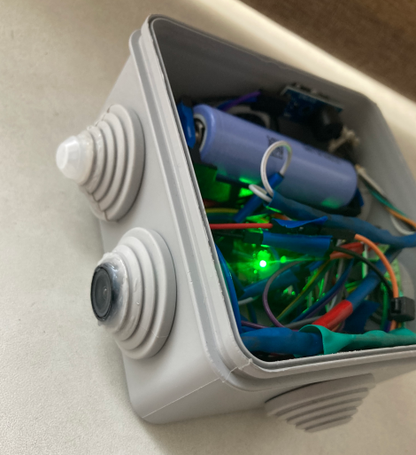
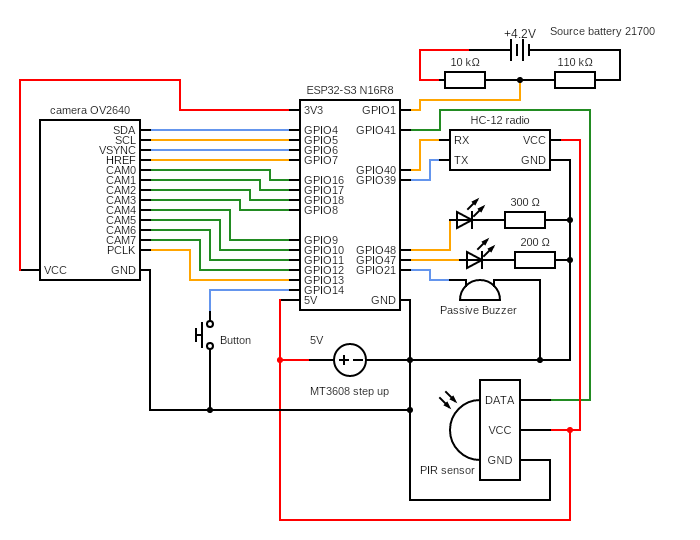
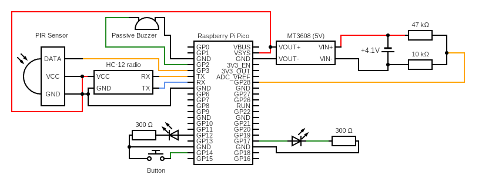
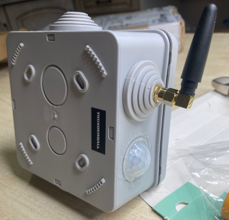

#  MicroFence - perimeter security system on microcontrollers

**MicroFence** is a perimeter security system powered by **Raspberry Pi Pico** and **ESP32** microcontrollers. It combines hardware-based motion detection with **HC-12 wireless communication over distances of up to 1-2 km** to provide real-time motion detection, photo capture, reliable radio communication with the farmhouse, and instant Telegram alerts via the farmhouse Wi-Fi network.

The system consists of three types of devices: **PIR sensor nodes with cameras**, **PIR sensor nodes without cameras**, and a **guard host server**. The guard host, based on a **Raspberry Pi Pico W**, acts as the central radio server, receiving events from the sensor nodes. It is also connected to Wi-Fi to forward alerts to a Telegram channel and serves as a control bridge, allowing the user to remotely **arm or disarm the perimeter via commands from Telegram**.

## Features

*MicroFence* combines distributed sensors, long-range radio communication, and remote monitoring into a *simple perimeter security system* on microcontrollers. Its main features include:

* **Motion detection** — PIR sensors continuously monitor the protected perimeter when the system is armed.
* **Wireless radio communication** — Sensor nodes transmit events to the *Guard Host*, located in the farmhouse, via an HC-12 radio link.
* **Encrypted communication** — Messages and commands are protected using the *Skyfall radio protocol*.
* **Photo capture** — Camera-equipped nodes can capture images when motion is detected.
* **Telegram alerts** — The *Guard Host* forwards detection events and photos to Telegram via Wi-Fi.
* **Remote control** — The user can remotely arm or disarm the perimeter using text commands from the Telegram channel.
* **Distributed architecture** — Multiple sensor nodes can operate as part of a single perimeter security network.

Together, these features allow *MicroFence* to provide real-time perimeter monitoring while keeping the system lightweight, modular, and suitable for deployment across large areas in big farms/yards.

## Devices
The *MicroFence* system consists of three main device types, each serving a specific role in the network.

### Guard Host - Radio receiver in farmhouse
The central server of the system based on **RPi Pico RP2040 W**. It *receives motion events from all sensor nodes via HC-12 radio, connects to the farmhouse Wi-Fi network, and forwards alerts to Telegram*. It also provides remote *arm/disarm control*.

<table>
  <tr>
    <td><a href="assets/guard_host_schema.png"></a></td>
    <td><a href="assets/guard_host_photo.png"></a></td>
  </tr>
</table>

Pinout schema for RP2040 W ([**Guard Host**](/sources/guard_host/))

| RP2040 W Pin | Component Pin | Component    | Description              |
| :----------- | :------------ | :----------- | :----------------------- |
| `GPIO 4 (TX)`| `RX`          | HC-12 radio  | UART transmit            |
| `GPIO 5 (RX)`| `TX`          | HC-12 radio  | UART receive             |
| `GPIO 13`    | —             | LED          | Network/status indication|
| USB Type-C   | —             | Power supply | 5V power input           |

As shown in the circuit diagram above, the **Raspberry Pi Pico W (RP2040)** is connected to an LED on GPIO13 and to the HC-12 radio module via UART, using GPIO4 for TX and GPIO5 for RX. The device is powered through a USB Type-C connection and also features an onboard **ESP8285 Wi-Fi module** for wireless connectivity.

### Skyfall - PIR Sensor with camera
An advanced perimeter sensor based on the ESP32-S3 microcontroller. It combines a PIR motion sensor SR501 with a camera OV2640, allowing the node to detect motion and capture photos that then transmittes to the Guard Host via HC-12 module in **secure mode**.

<table>
  <tr>
    <td><a href="assets/skyfall_pir_photo.png"></a></td>
    <td><a href="assets/skyfall_pir_schema.png"></a></td>
  </tr>
</table>

Pinout schema for ESP32-S3 ([**Skyfall client**](/sources/skyfall_client/))

| ESP32-S3 Pin | Component Pin | Component| Description |
| :---| :--- | :--- | :--- |
| `3V3` | `VCC` | OV2640 camera | 3.3V power supply |
| `3V3` | `VCC` | Passive buzzer | 3.3V power supply |
| `GPIO 4` | `SDA` | OV2640 camera | Camera I²C data |
| `GPIO 5` | `SCL` | OV2640 camera | Camera I²C clock |
| `GPIO 6` | `VSYNC` | OV2640 camera | Vertical sync |
| `GPIO 7` | `HREF` | OV2640 camera | Horizontal reference |
| `GPIO 16`| `CAM0` | OV2640 camera | Camera data |
| `GPIO 17`| `CAM1` | OV2640 camera | Camera data |
| `GPIO 18`| `CAM2` | OV2640 camera | Camera data |
| `GPIO 8` | `CAM3` | OV2640 camera | Camera data |
| `GPIO 9` | `CAM4` | OV2640 camera | Camera data |
| `GPIO 10`| `CAM5` | OV2640 camera | Camera data |
| `GPIO 11`| `CAM6` | OV2640 camera | Camera data |
| `GPIO 12`| `CAM7` | OV2640 camera | Camera data |
| `GPIO 13`| `PCLK` | OV2640 camera | Pixel clock |
| `GPIO 14`| — | Momentary button | Secure/unsecure |
| `5V` | `VCC` | HC-12 radio | 5V power supply |
| `5V` | `VCC` | PIR sensor  | 5V power supply |
| `GPIO 1` | — | Battery divider | Battery voltage monitoring |
| `GPIO 39`| `TX` | HC-12 radio | UART receive |
| `GPIO 40`| `RX` | HC-12 radio | UART transmit |
| `GPIO 41`| `DATA` | PIR sensor | Motion detection input |
| `GPIO 47`| — | LED | Status indication for Button |
| `GPIO 48`| — | LED | Status indication for Buzzer |
| `GPIO 21`| `INPUT` | Passive buzzer | Buzzer control |
| `GND` | `GND` | All devices | Common ground |

As shown in the circuit diagram above, the **ESP32-S3** is powered by an **MT3608 step-up converter**, which is connected to a **21700 battery**. The **GND** and multiple **5V** wires from the MT3608 provide power to the ESP32-S3 microcontroller, HC-12 radio module and PIR sensor.

### Thunderball - PIR Sensor with NO camera
A lightweight perimeter sensor based on the Raspberry Pi Pico. It uses a PIR sensor to detect motion and sends detection events to the Guard Host via the HC-12 radio link without capturing images.

<table>
  <tr>
    <td><a href="assets/thunderball_schema.png"></a></td>
    <td><a href="assets/thunderball_photo.png"></a></td>
  </tr>
</table>

Pinout schema for RPi Pico ([**Thunderball client**](/sources/thunderball_client/))

| RPi Pico Pin | Component Pin | Component | Description |
| :--- | :--- | :--- | :--- |
| `GPIO 2` | `I/O` | Passive Buzzer | Buzzer control |
| `GPIO 3` | `OUT` | PIR Sensor | Motion detection signal |
| `GPIO 4 (TX)` | `RX` | HC-12 radio | UART transmit |
| `GPIO 5 (RX)` | `TX` | HC-12 radio | UART receive |
| `GPIO 12` | — | LED (300 Ω) | Button status indication |
| `GPIO 14` | — | Button | ARM/DISARM switching |
| `GPIO 17` | — | LED (300 Ω) | Buzzer status indication |
| `GPIO 28 (ADC2)` | — | Battery voltage divider (47 kΩ / 10 kΩ) | Battery voltage monitoring |
| `VSYS` | `VOUT+` | MT3608 (5V) | Power input |
| `GND` | `VOUT−` | MT3608 | Power input |
| `3V3_OUT` | `VCC` | Passive Buzzer | Buzzer power supply |
| — | `VIN+ / VIN−` | MT3608 | Battery input (~4.1 V) |

All other components, including the *PIR sensor, passive buzzer, HC-12 radio module, LEDs*, and *button*, share a common ground connected to the microcontroller's GND pins.

## Skyfall radio protocol
As described above, the system uses **HC-12 radio link** to communicate between devices, including sending messages, photo files, and encrypted commands received from Telegram.

At the software level, communication is handled by the **[`Skyfall radio protocol`](https://github.com/under0tech/skyfall_radio_protocol)**, a lightweight protocol designed for reliable communication between microcontrollers. It provides device identification, message routing, encrypted communication, and file transfer over the HC-12 link, allowing the MicroFence devices to securely exchange commands, sensor events, and data.

## Configuration
The **MicroPython source code**, configuration files, and firmware for each device are provided in the [`sources`](/sources/) folder of this repository.
To configure a device, upload the appropriate source files, including `main.py` and `definitions.py`, to the corresponding microcontroller using the **Visual Studio Code MicroPico vREPL extension** or another suitable development environment.

### Telegram bot setup
The **Guard Host**, located in the farmhouse, uses Telegram for notifications and remote control. To configure it properly, you will need to:

1. Message `@BotFather` on Telegram, create a new bot, and copy its **Bot Token**.
2. Create a Telegram channel, add your bot as an administrator, and obtain the **Channel ID**.

### Wi-Fi and Telegram configuration
Configure `definitions.py` on the Guard Host with your farmhouse Wi-Fi and Telegram credentials:
   ```python
   WIFI_NETWORK_NAME = "FARMHOUSE_WIFI_ROUTER_SSID"
   WIFI_NETWORK_PASSWORD = "FARMHOUSE_WIFI_ROUTER_PASSWORD"

   TELEGRAM_HOST = "api.telegram.org"
   TELEGRAM_BOT_ID = "bot0000000000:XXX_xXXXXXXXXXXXXXX-XXXXXXXX"  # Your bot token
   TELEGRAM_CHAT_ID = "-1001111111112"  # Your Telegram channel ID
   ```
Also configure the remaining parameters as required for your setup. The corresponding `definitions.py` files on the other devices must be configured as well. In particular, make sure to **replace the default HC-12 encryption keys with your own secret keys** on all devices.

## Get in touch
If you have any questions, feel free to reach out to me on Twitter: https://twitter.com/dmytro_sazonov
