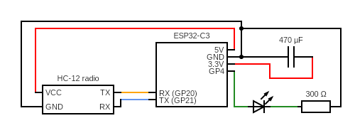
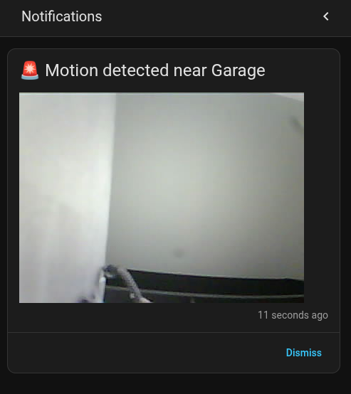
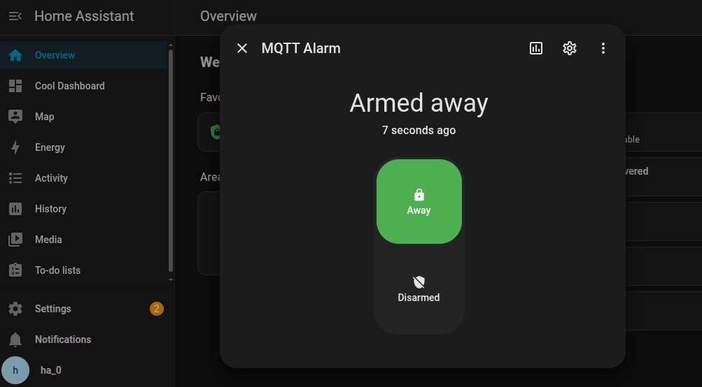
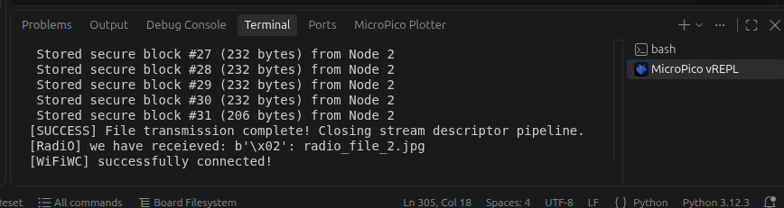

# Bronze Host – radio server (receiver) for the MicroFence security system

**Bronze Host** is a radio receiver device inspired by the **Guard Host** of the [**MicroFence**](https://github.com/under0tech/micro_fence) perimeter security system, built around **ESP32-C3** microcontroller. It integrates **HC-12 wireless communication** with a range of up to **1–2 km**, operating as a radio server and providing **Home Assistant integration** and **instant Telegram alerts** over the farmhouse Wi-Fi network.

## Features

The central server of the **MicroFence** security system is based on the **ESP32-C3** microcontroller. It receives motion events from all sensor nodes via HC-12 radio, connects to the farmhouse Wi-Fi network, and forwards alerts to Telegram and/or the Home Assistant server configured via the MQTT protocol. It also provides remote **arm/disarm control** via Home Assistant interface or Telegram messages.

## Schema

The circuit diagram below illustrates the ESP32-C3 microcontroller, HC-12 radio module, a **470 µF capacitor** used to stabilize the power supply during Wi-Fi transmission, and an LED for network status indication.



| ESP32-C3 Pin | Component Pin | Component | Description |
| :--- | :--- | :--- | :--- |
| `GPIO 21 (TX)` | `RX` | HC-12 radio | UART transmit |
| `GPIO 20 (RX)` | `TX` | HC-12 radio | UART receive |
| `GPIO 4` | — | LED | Network status indication |
| `3.3V` | `+` | Capacitor | Power supply stabilization |
| `5V` | `VCC` | HC-12 radio | Radio module power supply |
| `GND` | — | Common ground | Ground connection |
| USB Type-C | — | Power supply | 5V power input |

The ESP32-C3 communicates with the HC-12 module over UART, enabling wireless communication with remote sensor nodes. The LED indicates the network connection status, while the 470 µF capacitor helps stabilize the power supply during peak current consumption. The USB Type-C connector provides the device with 5V power.

## Firmware

To install the appropriate firmware, refer to the [`firmware`](firmware/) directory and follow the instructions in [`firmware/INSTALL.md`](firmware/INSTALL.md).

## Configuration

All device settings, including Wi-Fi credentials, Telegram and Home Assistant configuration, HC-12 radio keys and IDs, and GPIO pin assignments, must be specified in the corresponding sections of `definitions.py`.

### Telegram bot setup
The **Bronze Host**, located in the farmhouse, uses Telegram for notifications and remote control. To configure it properly, you will need to:

1. Message `@BotFather` on Telegram, create a new bot, and copy its **Bot Token**.
2. Create a Telegram channel, add your bot as an administrator, and obtain the **Channel ID**.

### Wi-Fi and Telegram configuration
Configure `definitions.py` on the Bronze Host with your farmhouse Wi-Fi and Telegram credentials:
   ```python
   WIFI_NETWORK_NAME = "FARMHOUSE_WIFI_ROUTER_SSID"
   WIFI_NETWORK_PASSWORD = "FARMHOUSE_WIFI_ROUTER_PASSWORD"

   TELEGRAM_HOST = "api.telegram.org"
   TELEGRAM_BOT_ID = "bot0000000000:XXX_xXXXXXXXXXXXXXX-XXXXXXXX"  # Your bot token
   TELEGRAM_CHAT_ID = "-1001111111112"  # Your Telegram channel ID
   ```
Also configure the remaining parameters as required for your setup. The corresponding `definitions.py` files on the other slave devices must be configured as well. In particular, make sure to **replace the default HC-12 encryption keys with your own secret keys** on all devices.

## Home Assistant Configuration

**Bronze Host** integrates with [*Home Assistant (HA)*](https://www.home-assistant.io/installation/raspberrypi) via MQTT, enabling sensor event reporting, device status monitoring, and remote arming/disarming of the security system.

The following parameters in `definitions.py` configure the MQTT connection and device identification:

- `MQTT_USER` – MQTT broker username.
- `MQTT_PASSWORD` – MQTT broker password.
- `MQTT_DEVICES` – Mapping of sensor node IDs to their device types (e.g., `camera`, `pir`).
- `MQTT_UPDATES_TIMEOUT_MS` – Timeout in milliseconds for receiving MQTT updates.
- `MQTT_NEEDS_REPORT` – Enables or disables reporting to Home Assistant.

These settings ensure proper communication between **Bronze Host** and Home Assistant, allowing the security system to report *perimeter security events* and receive remote control commands over MQTT.

## Usage

To use this version, you must have a properly configured Home Assistant environment with the required settings. For picture examples look below.

<table>
  <tr>
    <td>
      <a href="assets/ha_perimeter_alert.png">
        
      </a>
    </td>
    <td>
      <a href="assets/ha_security.png">
        
      </a>
    </td>
  </tr>
  <tr>
    <td colspan="2">
      <a href="assets/bronze_host_log.png">
        
      </a>
    </td>
  </tr>
</table>

As shown in the pictures above, the first image displays a security perimeter disturbance notification sent from the PIR sensor with a camera to Home Assistant (HA). The second image shows the interface used to arm and disarm all configured security devices. The image below shows the execution log from **Bronze Host** radio-server device.

## Get in touch
If you have questions, feel free to reach out to me on Twitter: https://twitter.com/dmytro_sazonov

